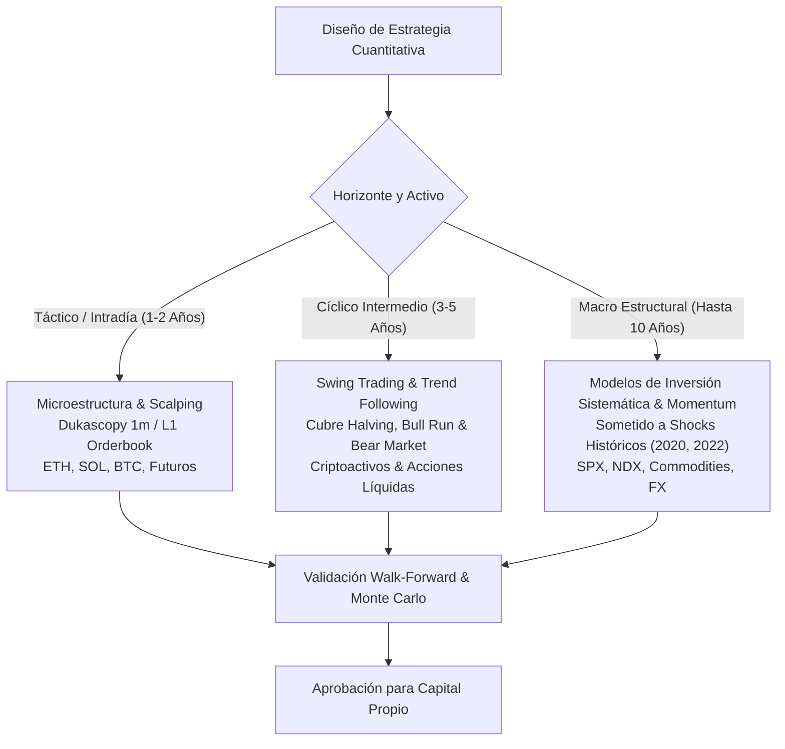

# 🏛️ Lección Aprendida y Directiva de Gobernanza: `LESSON-20261028-014`
## Metodología Integral de Validación Cuantitativa, Regímenes y Gestión de Riesgo para Capital Propio

### 1. Contexto y Separación Radical: Capital Propio vs. Prop Firms
En sesión del 28 de octubre de 2026, Sergio establece las bases cuantitativas definitivas para el despliegue de **Capital Propio** en AlgrokQuant y OpenMausBot. 
A diferencia de los retos de fondeo (Lucid Trading, Tradeify) cuya meta es superar un target del $+6.0\%$ en pocas semanas bajo restricciones extremas de End-of-Day Drawdown ($3.5\% - 4.0\%$), el capital propio está diseñado para la **acumulación patrimonial y el interés compuesto a largo plazo**, exigiendo modelos capaces de sobrevivir y prosperar a través de ciclos macroeconómicos completos.

---

### 2. Tabla Maestra de Parámetros Supremos (Capital Propio)

| Parámetro / Métrica | Estándar Oficial AlgrokQuant (Capital Propio) | Justificación Cuantitativa |
| :--- | :--- | :--- |
| **Max Drawdown de la Cuenta** | **$20.0\%$ Máximo** (Peak-to-Trough continuo) | Límite estructural de preservación del capital. Permite sortear la volatilidad natural sin comprometer la capacidad de recuperación geométrica. |
| **Rentabilidad Mínima Neta** | **$\ge 30.0\%$ Anual Compuesta** (`LESSON-004`) | Umbral exigido tras comisiones y slippage real. Modelos con menor rendimiento quedan descartados. |
| **Alpha vs. Buy & Hold** | **Superación Obligatoria del Benchmark Spot** | La estrategia debe superar la rentabilidad del activo subyacente en el mismo periodo y generar retorno positivo en fases bajistas. |
| **Métrica Primaria de Optimización** | **MAR Ratio ($\text{CAGR} / \text{Max DD}$) $\ge 1.50$** y **Sortino** | Prioriza la consistencia del retorno castigando exclusivamente la volatilidad negativa (*downside risk*). |
| **Modelo de Gestión de Riesgo** | **Porcentual Dinámico ($\% \text{ Equity}$)** | Prohibición absoluta de importes fijos en dólares ($200 - $300). Sizing adaptativo según volatilidad (ATR/Half-Kelly). |
| **Riesgo Base por Operación** | **$0.50\% - 1.50\%$ del balance vivo** | Escala con el crecimiento del equity y se contrae automáticamente durante las fases de drawdown. |
| **Monitorización de Régimen** | **Análisis Continuo Ininterrumpido** | Clasificación macro activa permanente (Tendencia Alcista, Tendencia Bajista, Rango/Chop, Shock de Volatilidad). |
| **Nivel de Alerta al -10% DD** | **Auditoría Profunda de Régimen** | Al alcanzar $-10\%$ de drawdown se audita de inmediato la compatibilidad del mercado. **NO se reduce el riesgo a la mitad arbitrariamente**. |
| **Hard Kill-Switch al -20% DD** | **Desconexión Forzosa Inmediata** | Desactivación del bot runner y congelación de aperturas para investigación forense. |

---

### 3. Horizontes Temporales de Backtesting y Robustez
Las estrategias ya no se aprueban con micro-muestras cortoplacistas. El espectro de validación se divide en tres horizontes obligatorios según la naturaleza del activo y la frecuencia operativa:

1. **Horizonte Táctico / Micro (1 a 2 Años):**
   - Aplicable a estrategias intradía (1m, 5m, 15m).
   - Exige granularidad de datos por tick o barra de 1 minuto con bid/ask real (Dukascopy / Hyperliquid L1) para capturar spreads, funding y fricciones.
2. **Horizonte Cíclico Intermedio (3 a 5 Años):**
   - Obligatorio para estrategias tendenciales en cripto. Debe contener obligatoriamente al menos:
     - Una fase de expansión parabólica (Bull Market).
     - Una fase de capitulación profunda $\ge 60\%$ (Crypto Winter / Bear Market).
     - Una fase prolongada de compresión y lateralidad (Chop).
3. **Horizonte Macro Estructural (hasta 10 Años):**
   - Aplicable a índices (S&P 500, Nasdaq 100), materias primas y divisas.
   - Pone a prueba la robustez frente a cambios de política monetaria (QE vs QT), shocks de volatilidad repentinos (marzo 2020) y transiciones de inflación.

---

### 4. Régimen de Mercado Continuo y Protocolo de Drawdown

#### 4.1. Monitorización Continua
El enjambre no evalúa el régimen únicamente como reacción a las pérdidas. El régimen se calcula y actualiza **de forma continua en cada ciclo de barra** a través de:
1. **Direccionalidad Macro:** Pendiente y curvatura de medias adaptativas (Kaufman AMA / EMA 200) y filtros de Kalman.
2. **Entropía de Shannon:** Medición del orden/caos en la distribución de retornos y volumen (`LESSON-20261025-013`).
3. **Volatilidad Relativa:** Ratio ATR actual vs. mediana histórica de 100 periodos y bandas de Bollinger %B.

#### 4.2. Protocolo de Defensa Escalonado
- **Zona Normal ($0.0\% \text{ a } -9.9\%$ DD):**
  - La estrategia opera con su asignación de riesgo porcentual nominal ($0.75\% - 1.25\%$).
  - Las posiciones se dimensionan dinámicamente según la distancia al Stop Loss (volatility-adjusted sizing).
- **Zona de Alerta e Intervención (-10.0% DD):**
  - **Auditoría de Régimen Activada:** Nexus y Auditor ejecutan de inmediato un diagnóstico para determinar si el subyacente ha entrado en un régimen adverso no contemplado en el diseño.
  - **Directiva de Riesgo:** **NO se reduce el tamaño del trade a la mitad.** Reducir el riesgo en el fondo de un drawdown habitual perjudica matemáticamente la velocidad de recuperación de la curva cuando la estrategia vuelve a estar en fase favorable. Se preserva el sizing optimizado, pero se revisa la validez del régimen antes de permitir nuevas órdenes.
- **Zona de Parada Forzosa / Hard Kill-Switch (-20.0% DD):**
  - Desconexión automática e irrevocable del runner.
  - Pase inmediato a la biblioteca de cuarentena para análisis de descomposición de alpha.

---

### 5. Bidireccionalidad Asimétrica (Compras y Ventas Desacopladas)
Las estrategias para capital propio no deben asumir simetría entre posiciones largas y cortas:
- **Longs:** En renta variable y cripto, las subidas suelen ser graduales, con volatilidad decreciente y duraciones prolongadas (sesgo estructural alcista a largo plazo).
- **Shorts:** Las caídas son abruptas, violentas, acompañadas de picos de volatilidad y contracción de liquidez.
- **Regla de Diseño:**
  - Los parámetros de entrada, trailing stop, toma de beneficios y filtros de confirmación para posiciones cortas deben configurarse y optimizarse de forma **independiente y asimétrica** respecto a las posiciones largas.

---

### 6. Aprendizaje y Adaptabilidad: Q-Learning / Bandit Algorithms vs. Caja Negra
Ante la consulta sobre *k-learning* (Q-Learning / Reinforcement Learning):
- **Cajas Negras No Deterministas (Prohibidas en Ejecución Directa):** No se permite que un agente de Deep RL opere directamente disparando órdenes aleatorias o aprendiendo en vivo con capital real, debido al riesgo de alucinación estocástica y catástrofe por cambio de régimen no estacionario.
- **Meta-Aprendizaje Contextual (Aprobado):** Se implementa el aprendizaje por refuerzo a nivel de **meta-asignación (Contextual Multi-Armed Bandits)**:
  - El algoritmo selecciona y pondera qué sub-estrategia pre-validada (Trend vs Mean Reversion) recibe capital en función del régimen de mercado identificado, ajustando los pesos de forma determinista y auditable.

---

### 7. Optimización In-House y Out-Of-Sample en el Servidor (VectorBT)
El VPS (8 GB RAM, 5.8 GB libres) cuenta con capacidad de cálculo suficiente para ejecutar flujos avanzados de optimización similares a *StratFinder*:
1. **Walk-Forward Optimization (WFO):**
   - División de la serie temporal en ventanas rodantes In-Sample (optimización) y Out-Of-Sample (validación a ciegas).
   - Exigencia de un *Walk-Forward Efficiency (WFE)* ratio $\ge 60\%$.
2. **Análisis de Meseta de Parámetros (Parameter Plateau Stability):**
   - Prohibición estricta de elegir "picos aislados" de rentabilidad en los mapas de calor (indicador inequívoco de overfitting).
   - Solo se aceptan parámetros ubicados en el centro de mesetas de alto rendimiento donde variaciones de $\pm 15\%$ en los parámetros sigan generando beneficios sólidos.
3. **Pruebas de Esfuerzo de Monte Carlo:**
   - 1,000 permutaciones de la secuencia de operaciones para verificar que el $95\%$ de las simulaciones permanezcan con un drawdown inferior al $20.0\%$.

---

### 8. Asignación de Responsabilidades en el Enjambre

- **Nexus (Desk Lead):**
  - Supervisa que toda estrategia de capital propio respete la directiva de drawdown máximo del $20\%$.
  - Desencadena la auditoría macro cuando cualquier modelo toque el $-10\%$ de DD.
- **StratFinder & Ideator:**
  - Diseñan modelos multianuales (1 a 10 años) con reglas asimétricas separadas para compras y ventas.
  - Aseguran un potencial neto anualizado $\ge 30\%$ que supere al Buy & Hold.
- **CoderQuant:**
  - Implementa el dimensionamiento porcentual dinámico (`% Equity`) y los scripts de Walk-Forward Optimization con VectorBT.
- **Auditor & Skeptic:**
  - Verifican los mapas de calor de parámetros en busca de mesetas estables.
  - Rechazan cualquier estrategia con sobreajuste o picos frágiles.
- **RiskFilter:**
  - Aplica de forma incondicional el límite de riesgo por trade ($0.50\% - 1.50\%$) y el Hard Kill-Switch al $-20\%$ de drawdown.
