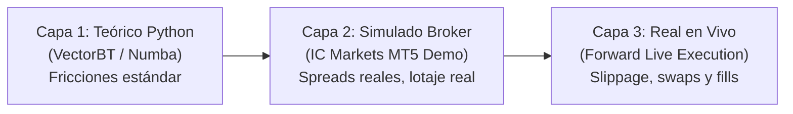

# LESSON-20261028-018: Gobernanza Cuantitativa Trifacética
## (Validación Obligatoria en 3 Capas: Teórico Python, Simulado Broker y Real en Vivo)

> [!IMPORTANT]
> **DIRECTIVA MAESTRA DE GOBERNANZA EMITIDA POR SERGIO (2026-10-28):**  
> *"Cuando encontremos una estrategia nueva en el backtest teórico de Python, es obligatorio realizar siempre este mismo contraste en IC Markets y reflejar en nuestro dashboard y archivos internos de forma triplicada las tres capas de datos: Backtest de Python, Simulación de Broker y Ejecución Real en Directo."*

---

## 1. Fundamento de la Regla de las 3 Capas

Ningún algoritmo puede ser catalogado ni considerado apto para asignación de capital basándose exclusivamente en un backtest en código puro. Todo modelo cuantitativo debe atravesar y mostrar de forma persistente tres facetas:

### Capa 1: Backtest Teórico Python (VectorBT / Numba)
* **Objetivo:** Filtrado masivo en mesetas paramétricas y auditoría causal de hipótesis.
* **Datos:** Datos parquet históricos con comisiones estándar (5 bps en futuros, 1.5 bps en forex).
* **Función:** Demostrar que existe un *edge* estadístico superior al azar.

### Capa 2: Simulado Broker (IC Markets CFD / Demo)
* **Objetivo:** Aterrizar el modelo a la microestructura real del broker donde operamos.
* **Datos:** 
  * Tickers específicos de broker (`USTEC`, `US500`, `EURUSD`).
  * Tamaño de contrato real (`trade_contract_size = 1.0` en índices, `100,000` en forex).
  * Lote mínimo (`0.10` en índices, `0.01` en forex).
  * Spreads reales (1.5 pts en Nasdaq, 0.4 pts en S&P 500, 0.8 pips en EUR/USD).
  * Dimensionamiento monetario ajustado al balance de la cuenta (\$1.000 USD de capital propio).
* **Función:** Detectar si el coste de spread o el tamaño mínimo de lote erosionan el beneficio o elevan el drawdown por encima del límite permitido.

### Capa 3: Ejecución Real en Directo (Forward Live MT5)
* **Objetivo:** Auditar el comportamiento en tiempo real con órdenes en el libro.
* **Datos:**
  * Slippage real medido entre señal y fill (`deal.price`).
  * Ensanchamiento de spread durante el rollover nocturno (23:00 - 23:15 UTC).
  * Coste de financiación diaria (*Overnight Financing / Swaps*).
* **Función:** Confirmar que la latencia (1.5s) y la liquidez de mercado no degradan la expectativa matemática.

---

## 2. Implementación en el Dashboard y Archivos Internos

1. **Almacenamiento Canónico:**  
   Fichero `/root/AlgrokQuant/data/tri_facet_strategies.json` que contiene el desglose tripartito de KPIs (`python_backtest`, `broker_simulated`, `live_real`) para cada estrategia aprobada.
2. **API Endpoint del Dashboard:**  
   Expuesto institucionalmente en:
   $$\text{GET } \mathtt{/api/strategies/tri\_facet}$$
   Permite al frontend y a los motores de reporte visualizar y graficar en paralelo las tres curvas de equidad y matrices de KPIs.
3. **Protocolo del Enjambre de Agentes:**  
   Cuando `@CoderQuant` o `@Nexus` descubran un nuevo modelo en Python, están terminantemente obligados a calcular y adjuntar la capa simulada de IC Markets antes de presentarlo al auditor.
