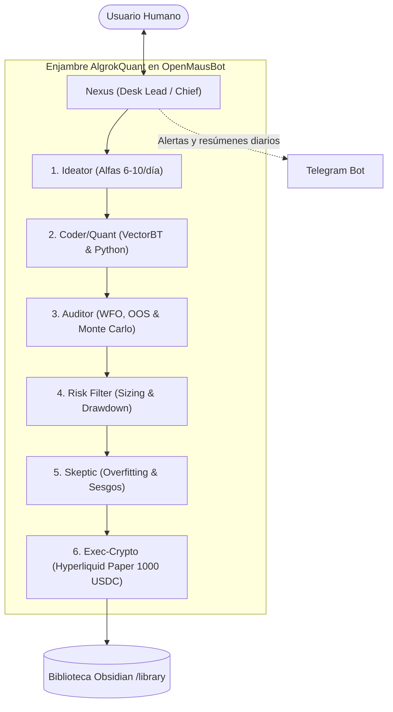

# 🤖 OpenMausBot & AlgrokQuant — Estado del Proyecto & Registro de Sesión

**Última Actualización:** 2026-10-21 13:25 UTC  
**Estado General:** Plataforma **OpenMausBot** desplegada y operativa en modo 24/7 en el servidor VPS de Contabo (`169.58.230.132`) con acceso HTTPS/TLS multicliente (PC y Móvil). Enjambre de 7 agentes de **AlgrokQuant** totalmente configurado y auditado con la especificación definitiva del proyecto, motor **Google Gemini 3.8 Flash High** (coste 0€) y pila completa de librerías cuantitativas (`vectorbt`, `ccxt`, `pandas`, `scipy`, `hyperliquid-python-sdk`, `python-telegram-bot`) instaladas y disponibles globalmente.

---

## 📌 1. Resumen Ejecutivo de la Sesión

1. **Despliegue y Convivencia en VPS Contabo (`169.58.230.132`):**
   - Configurado swap de 4.0 GiB (`/swapfile`, `vm.swappiness = 25`).
   - Node.js 24 LTS (`v24.22.0`), pnpm 12.14.0 y `openmausbot@0.1.120` instalados globalmente.
   - Demonio `openmausbot.service` corriendo en paralelo con los 3 servicios de TrAIding Hub sin colisión alguna.
   - Acceso HTTPS seguro bajo dominio `https://169.58.230.132.sslip.io` con certificados automáticos de Let's Encrypt vía Caddy.

2. **Acceso Multidispositivo Activo:**
   - Sesiones persistentes de administrador autorizadas tanto para el PC (Windows) como para el teléfono móvil (Oppo).
   - Generación de códigos de emparejamiento automatizada mediante `scripts/pair_vps.py`.

3. **Autenticación del Motor de IA (Coste 0€):**
   - Motor: **Google Gemini 3.8 Flash High** autenticado y verificado vía Antigravity / Google AI Studio.
   - **Sustitución oficial:** Sustituida la dependencia anterior de la API de GrokBot / plan Premium de X por la arquitectura soberana en OpenMausBot, eliminando costes mensuales y restricciones de tokens.

4. **Estructura y Configuración del Proyecto AlgrokQuant:**
   - Directorio raíz: `/root/AlgrokQuant/`.
   - Subcarpetas creadas: `config/`, `data/raw`, `data/processed`, `data/paper_trades`, `strategies/fast`, `strategies/robust`, `strategies/live_paper`, `strategies/archive`, `library/`, `logs/`, `scripts/`, `reports/`, `docs/`.
   - Archivo `risk_rules.yaml` creado con reglas exactas: 1000 USDC paper Hyperliquid, límites Fast (1% riesgo, 28% max DD, Sharpe >= 0.80) vs. Robust (0.75% riesgo, 20% max DD, Sharpe >= 1.10).
   - Archivo `tracks.yaml` y plantillas de configuración (`telegram.env`, `hyperliquid.env`).

5. **Roster Completo de 7 Agentes en OpenMausBot (`/root/.openmausbot/bots.json`):**
   - **Nexus:** Desk Lead y Coordinador Único (Chief of Staff). Único punto de contacto con el humano.
   - **Ideator:** Generador de Alfas (6–10 ideas diarias, prioridad Track Fast).
   - **CoderQuant:** Desarrollador Quant (Python & VectorBT).
   - **Auditor:** Auditor de Robustez (Walk-Forward, Out-of-Sample, Monte Carlo).
   - **RiskFilter:** Gestor de Riesgo y Sizing (aplica `risk_rules.yaml`).
   - **Skeptic:** Destructor de Sesgos (búsqueda de overfitting, look-ahead bias y comisiones).
   - **ExecCrypto:** Ejecutor Paper Trading en Hyperliquid Testnet (1000 USDC).
   - **Regla Suprema de Idioma:** Todos los agentes configurados estrictamente en **Español (España - es-ES)**.

6. **Pila de Dependencias Cuantitativas Instalada y Globalizada:**
   - Entorno virtual en `/root/AlgrokQuant/venv`.
   - Instaladas: `numpy`, `pandas`, `scipy`, `vectorbt` (1.2.0), `numba` (0.68.0), `ccxt` (4.5.89), `hyperliquid-python-sdk` (0.24.0), `python-telegram-bot` (22.8), `pyyaml`, `requests`, `matplotlib`, `plotly`, `tabulate`.
   - Wrappers globales en `/usr/local/bin/python3`, `/usr/local/bin/python`, `/usr/local/bin/pip` para ejecución directa en cualquier terminal o llamada de agente.

7. **Documentación Maestra Sincronizada:**
   - Creado y sincronizado `docs/ALGROKQUANT_SPEC.md` tanto en el workspace local como en el servidor (`/root/AlgrokQuant/docs/ALGROKQUANT_SPEC.md`, `/root/AlgrokQuant/README.md` y `/root/AlgrokQuant/library/00_MANIFIESTO_Y_ESPECIFICACION.md` para la bóveda Obsidian).

---

## 🌐 2. Estado de Servicios y Telemetría en el VPS (`169.58.230.132`)

```text
               total        used        free      shared  buff/cache   available
Memoria RAM:   7.8Gi       1.6Gi       4.8Gi       1.0Mi       1.4Gi       6.1Gi
Swap:          4.0Gi          0B       4.0Gi
Disco NVMe:     96Gi       8.1Gi        88Gi (8% en uso)
```

| Servicio Systemd | Función | Dirección / Puerto | Estado |
| :--- | :--- | :--- | :--- |
| **`openmausbot.service`** | Fleet Harness & Caddy Reverse Proxy | `https://169.58.230.132.sslip.io` (internos 8799/8800) | **`active (running)`** |
| **`traidinghub.service`** | Dashboard Streamlit de TrAIding Hub | `http://169.58.230.132:8501` | **`active (running)`** |
| **`traidinghub-bot.service`** | Bot Interactivo de Telegram (Hub) | N/A | **`active (running)`** |
| **`traidinghub-incubator.service`**| Minería de Alfas y Backtest 24/7 | N/A | **`active (running)`** |

---

## 🏛️ 3. Especificación Auditada de AlgrokQuant



---

## 🛠️ 4. Comandos de Operación y Administración

### Local (PowerShell):
```powershell
# Generar nuevo enlace de emparejamiento para PC o móvil:
python scripts/pair_vps.py

# Listar todos los bots y estados:
python scripts/list_all_bots.py
```

### En el Servidor VPS (SSH):
```bash
# Ver estado del servidor OpenMausBot:
systemctl status openmausbot.service

# Comprobar stack de análisis cuantitativo:
python3 -c "import vectorbt, ccxt, pandas, hyperliquid; print('Stack OK')"

# Ver logs de eventos en tiempo real:
journalctl -u openmausbot -f
```
