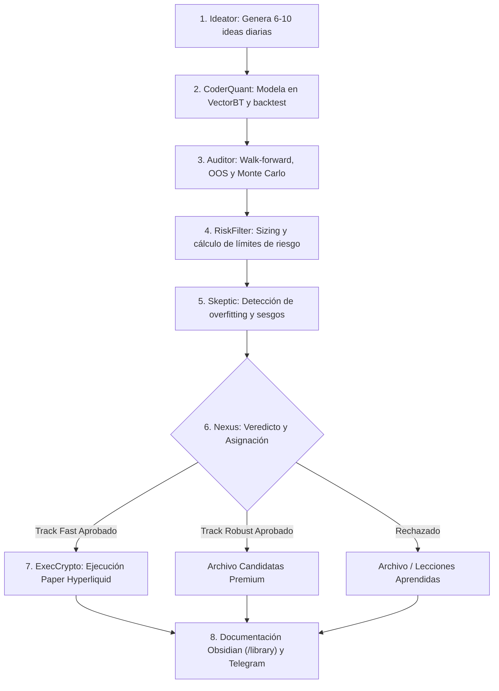

# Documento Completo y Definitivo del Proyecto AlgrokQuant

Este es el documento de referencia oficial y especificación maestra del proyecto **AlgrokQuant**.

---

## 1. Datos Generales

- **Nombre del proyecto:** AlgrokQuant
- **Nombre del coordinador (Desk Lead):** Nexus
- **Objetivo principal:** Crear un enjambre de agentes de IA en **OpenMausBot** (motor `gemini-3.8-flash-high` vía Google Antigravity / AI Studio) que genere, filtre, robustezca y ejecute estrategias de trading algorítmico de forma autónoma.
- **Capital inicial:** Exactamente **1.000 USDC** en cuenta paper/demo.
- **Mercado permitido actualmente:** Solo criptomonedas (spot + perpetuos).
- **Exchange paper prioritario:** Hyperliquid (Testnet).
- **Temporalidades permitidas:** 1m, 5m, 15m y 1h.
- **Tipo de datos:** Únicamente fuentes gratuitas (CCXT, Binance/Hyperliquid public API, Yahoo Finance).
- **Presupuesto:** 0 € (todo gratuito).
- **Entorno de ejecución y tokens:** Alojado en OpenMausBot sobre servidor privado (VPS Contabo) utilizando el motor Google Gemini 3.8 Flash High sin coste de suscripción ni agotamiento de cuotas de X / Grok.
- **Estilo de trading:** Libertad total (sin restricciones adicionales de estilo por el momento).
- **Dinero real:** Prohibido. Solo paper trading hasta nuevo aviso.
- **Idioma del proyecto:** Español (España - `es-ES`) como idioma supremo y obligatorio para todas las interacciones, razonamientos, notas de Obsidian y código documentado.

---

## 2. Tracks de Trabajo (Doble Vía en Paralelo)

### Track Fast
- **Objetivo:** Poner estrategias a operar en paper lo antes posible.
- **Filtros:** Más permisivos para acelerar el ciclo de prueba y aprendizaje en mercado vivo simulado.
- **Prioridad:** Máxima prioridad de recursos al inicio del proyecto.

### Track Robust
- **Objetivo:** Encontrar estrategias de alta calidad y robustez estadística a largo plazo.
- **Filtros estrictos:** Walk-Forward Analysis, Out-of-Sample (OOS), simulaciones Monte Carlo básicas y matrices de correlación.
- **Destino:** Las estrategias que superan este track se archivan como candidatas premium y se promueven a paper o escalado posterior.

*Ambos tracks operan de forma simultánea bajo la supervisión y orquestación de Nexus.*

---

## 3. Roster de Agentes (Versión Ligera)

### Agentes activos desde el inicio:
| Agente | Rol Principal | Responsabilidad |
| :--- | :--- | :--- |
| **Nexus** | Coordinador único (Desk Lead) | Único agente que se comunica con el usuario humano. Dirige y asigna tareas al resto del enjambre. |
| **Ideator** | Generador de Alfas | Genera entre 6 y 10 ideas de estrategias cuantitativas al día (priorizando Track Fast al inicio). |
| **CoderQuant** | Desarrollador Quant | Traduce ideas a código Python (VectorBT prioritario) y realiza backtests iniciales con métricas estándar. |
| **Auditor** | Especialista en Robustez | Somete las estrategias a pruebas de robustez: Walk-Forward, Out-of-Sample y Monte Carlo básico. |
| **RiskFilter** | Gestor de Riesgo | Calcula el dimensionamiento de posición (sizing), aplica los límites de `risk_rules.yaml` y emite el veredicto (Aprobada/Rechazada). |
| **Skeptic** | Destructor de Sesgos | Agente adversario: busca overfitting, look-ahead bias, costes ocultos de slippage/comisiones e intenta tumbar la estrategia. |
| **ExecCrypto** | Ejecutor Paper | Ejecución y monitorización de órdenes simuladas en Hyperliquid Testnet. Detiene operativa ante alertas. |

### Agentes previstos para Fase 2 (aún no creados):
- **Macro Expert** (Análisis macroeconómico, liquidez global y tipos).
- **Sentiment Rastreator** (Monitorización de sentimiento en redes sociales y derivados).

---

## 4. Estructura de Carpetas Obligatoria

```text
AlgrokQuant/
├── config/
│   ├── risk_rules.yaml      # Reglas cuantitativas de riesgo y límites de drawdown
│   ├── tracks.yaml          # Parámetros y umbrales diferenciados Fast vs. Robust
│   ├── telegram.env         # Credenciales de alertas para el bot de Telegram
│   └── hyperliquid.env      # Configuración de wallet y API paper de Hyperliquid
├── data/
│   ├── raw/                 # Datos brutos de mercado descargados (OHLCV)
│   ├── processed/           # Datos limpios y preparados para backtests
│   └── paper_trades/        # Registro de ejecuciones y órdenes simuladas
├── strategies/
│   ├── fast/                # Estrategias en desarrollo rápido
│   ├── robust/              # Estrategias aprobadas con filtros estrictos
│   ├── live_paper/          # Estrategias actualmente en ejecución paper en Hyperliquid
│   └── archive/             # Estrategias descartadas o históricas
├── library/                 ← Base de conocimiento oficial para Obsidian (Markdown)
├── logs/                    # Registros de eventos, ejecuciones y errores
├── scripts/                 # Scripts utilitarios y de automatización
└── reports/                 # Informes de rendimiento y resúmenes periódicos
```

---

## 5. Reglas de Riesgo (`risk_rules.yaml`)

```yaml
capital_paper: 1000
currency: USDC

risk_per_trade:
  fast: 0.01          # 1% por operación (Track Fast)
  robust: 0.0075      # 0.75% por operación (Track Robust)

max_daily_loss: 0.04  # 4% de pérdida máxima intradía

max_total_drawdown:
  fast: 0.28          # 28% Drawdown máximo tolerado en Fast
  robust: 0.20        # 20% Drawdown máximo tolerado en Robust

min_trades_required:
  fast: 40            # Mínimo 40 operaciones en backtest
  robust: 80          # Mínimo 80 operaciones en backtest

profit_factor_min:
  fast: 1.20          # Profit Factor mínimo para Fast
  robust: 1.40        # Profit Factor mínimo para Robust

sharpe_min:
  fast: 0.80          # Sharpe Ratio mínimo para Fast
  robust: 1.10        # Sharpe Ratio mínimo para Robust

expectancy_min: 0.0   # Esperanza matemática positiva estricta

kill_switch: true
position_sizing: "risk_based"
allowed_timeframes: ["1m", "5m", "15m", "1h"]
allowed_markets: ["crypto_spot", "crypto_perp"]
exchange_paper: "hyperliquid"
```

---

## 6. Características y Funcionalidades

1. **Generación autónoma de estrategias:** Medias móviles, breakout de canales, reversión a la media, funding rate arbitrage, order-flow básico, contracción/expansión de volatilidad, etc.
2. **Backtesting prioritario con VectorBT:** Vectorización de alta velocidad en Python con modelado de comisiones y slippage.
3. **Filtros diferenciados por Track:** Agilidad en Fast vs. rigor estadístico en Robust.
4. **Registro estructurado para Obsidian:** Cada estrategia, lección aprendida y auditoría se vuelca en `/library` en Markdown limpio con frontmatter YAML compatible con Obsidian.
5. **Control y reportes vía Telegram:** Notificaciones automáticas de alertas, aperturas/cierres de trades y resúmenes diarios de PnL.
6. **Kill-Switch automático:** Corte de operativa inmediato ante breach de drawdown diario o acumulado.
7. **Position sizing basado en riesgo:** Tamaño de posición en función de la distancia al Stop Loss y el porcentaje de riesgo asignado.
8. **Documentación exhaustiva:** Trazabilidad completa de la idea original, código, auditoría, veredicto de riesgo y ejecución.

---

## 7. Elementos Aplazados (No se implementan ahora)

- Modo Prop Firm (desafíos y reglas de cuentas de fondeo) → Aplazado para Fase 4.
- Jev (modelo de decisiones de ultra-corta latencia) → Aplazado.
- OpenClaw → Descartado / No se usa.
- Forex e índices tradicionales (NQ/ES) → Aplazado para fases posteriores.
- Scalping puro de muy alta frecuencia (HFT sub-segundo) → Fuera de alcance inicial.
- Q-learning y Deep Reinforcement Learning completo → Aplazado para Fase 3.
- Macro Expert y Sentiment Rastreator → Aplazados para Fase 2.

---

## 8. Fases del Proyecto

- **Fase 0 (Actual):** Creación del enjambre + estructura de carpetas + configuración de `risk_rules.yaml` + integración Telegram + conexión paper Hyperliquid + preparación de biblioteca Obsidian.
- **Fase 1 (Fast-Track):** Puesta en marcha de las primeras estrategias en paper en Hyperliquid con ciclo rápido de retroalimentación.
- **Fase 2 (Dual Track Completo):** Activación de Track Robust con filtros cuantitativos profundos + activación de agentes Macro y Sentiment + sincronización continua de Obsidian.
- **Fase 3 (Optimización):** Endurecimiento de filtros, modelos de aprendizaje adaptativo básico y promoción de estrategias robustas a paper prioritario.
- **Fase 4 (Escalado):** Auditoría final de resultados paper y evaluación de transición a capital real o evaluación de retos Prop Firm.

---

## 9. Flujo de Trabajo Diario Estándar



---

## 10. Estado Técnico Actual

- Todos los agentes del roster ligero (**Nexus, Ideator, CoderQuant, Auditor, RiskFilter, Skeptic, ExecCrypto**) están creados, registrados y operativos en OpenMausBot bajo el equipo `AlgrokQuant`.
- Espacio de trabajo común: `/root/AlgrokQuant`.
- Reglas cuantitativas consolidadas en `risk_rules.yaml`.
- Pila de dependencias de Python y análisis cuantitativo en despliegue.
