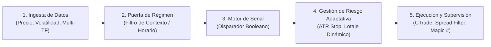

# 01. Arquitectura de Sistemas Algorítmicos y Diseño de Bots

> **Fuente:** Extracción técnica del canal `@Techain_Trading_Bots` (Ignacio N. Ayago) — 119 vídeos analizados.
> **Enfoque:** Ingeniería de sistemas cuantitativos, separación entre motor de señales y puertas de régimen, objetivación matemática de reglas y microestructura de ejecución en MetaTrader 4/5.

---

## 1. El Paradigma Cuantitativo: "Estrategia" vs. "Sistema"

Uno de los pilares centrales que repite Ignacio Ayago a lo largo de todo su contenido es que **una condición de entrada no es un sistema de trading**. El 73 % de las cuentas de trading automático mueren antes de 6 meses no por falta de ideas de entrada, sino por **falta de filtros de contexto y capas de protección**.

Un **Sistema Algorítmico Profesional** se compone de **5 capas secuenciales** (leídas de izquierda a derecha en un grafo de nodos como *StratOS* o en el flujo de ejecución de `OnTick()`):

### Regla de Oro de Diseño: "Si no se puede escribir con números, no existe"
* En el trading discrecional (Price Action, Smart Money Concepts, Oferta y Demanda), el ojo humano sufre de **sesgo retrospectivo (*hindsight bias*)**: dibuja zonas sabiendo qué ocurrió después.
* Para programar o validar un algoritmo, **toda regla subjetiva debe convertirse en condiciones booleanas cerradas (`True` / `False`)** basadas en múltiplos de volatilidad (`ATR`), conteo de velas (`N` barras) o desviaciones estadísticas (`Z-Score`).

---

## 2. Separación Estricta entre "Señal" y "Puerta" (Filtros de Régimen)

El mayor salto de calidad en el rendimiento de un bot no proviene de cambiar el indicador de entrada, sino de **silenciar el motor de entrada cuando el régimen de mercado le es hostil** (*"La mayor parte de la ventaja no está en las señales que da un sistema, sino en las que se niega a dar"* — Vídeo #003 y #006).

### Caso Demostrativo (Vídeo #006 - 35.766 velas en H1):
* **Mismo motor de entrada (cruce de medias):**
  * **Sin puerta de régimen:** Beneficio neto $-\$1.271$, *Profit Factor* $0.60$, *Win Rate* $24.1\%$, *Drawdown* $102.71\%$ (quiebra técnica).
  * **Con puerta de régimen (`ADX(14) > 25`):** Beneficio neto $+\$27.236$, *Profit Factor* $1.58$, *Win Rate* $45.8\%$, *Drawdown* $24.41\%$.

### Principios Técnicos de un Filtro de Régimen:
1. **El filtro actúa como puerta (`AND` lógico), jamás como disparador:** El `ADX` no decide si compras o vendes; solo decide si el disparador tiene permiso para enviar la orden al mercado.
2. **Importa el cambio de banda, no el decimal exacto:** A un filtro de régimen le da igual si el ADX marca 31 o 37; lo relevante es que cruzó del umbral de ruido ($<20\text{--}25$) al régimen direccional ($\ge 25$).
3. **Los filtros de régimen llegan tarde por diseño:** Un filtro de baja frecuencia está construido para ignorar el ruido. Perder el primer tramo de un movimiento es el "impuesto" necesario para no desangrarse en los tramos laterales.

---

## 3. Taxonomía de Regímenes de Mercado (Sistema A-B-C y Enrutador Inteligente)

Ignacio Ayago enfatiza que **ninguna estrategia tiene una esperanza matemática única**: tiene **una esperanza matemática distinta en cada régimen de mercado** (Vídeo #027, #052, #061).

### A. Los 7 Regímenes Canónicos (Smart Router / Catálogo Cuantitativo)
Utilizados para enrutar qué familia de bots debe operar en cada momento (Vídeos #020, #052, #061):
1. **Régimen 0 / 1 — Tendencia Alcista (`Bull Trend`):** Máximos y mínimos crecientes + pendiente positiva de media estructural + volatilidad controlada. *(Estrategias ideales: Ruptura Donchian + Retest, Seguimiento de tendencia).*
2. **Régimen 2 — Tendencia Bajista (`Bear Trend`):** Asimetría de velocidad (las caídas suelen ser más rápidas y con mayor expansión de volatilidad que las subidas). *(Estrategias ideales: Pullback a EMA rápida + filtro de agotamiento).*
3. **Régimen 3 — Rango / Lateral (`Range / Mean Reversion`):** `ADX < 20`, alto índice *Choppiness*. Donde mueren los sistemas tendenciales y brillan los sistemas cóncavos de reversión a la media (`Z-Score`, Bandas de Bollinger).
4. **Régimen 4 — Compresión / Pre-Ruptura (`Breakout / Squeeze`):** Contracción extrema de volatilidad (Bandas de Bollinger dentro de Canales de Keltner).
5. **Régimen 5 — Alta Volatilidad / Caos (`High Volatility`):** Expansión violenta del `ATR` (noticias macro, crisis geopolíticas). Protocolo habitual: **autopausa (*News Dodger*)** o reducción drástica de lotaje.
6. **Régimen 6 — Baja Volatilidad (`Low Volatility`):** Mercado lento / sesión asiática.
7. **Régimen 7 — Momentum / Impulso (`Momentum`):** Aceleración de la 2.ª derivada del precio (`ROC` + `ADX` creciente).

*(En el módulo avanzado de Gestión de Riesgo Adaptativa —Vídeo #027—, esta clasificación se expande a **10 sub-estados** diferenciando tendencia alcista/bajista en versiones calmada, normal y volátil, rango tranquilo vs. volátil, caos sin dirección y transición).*

---

## 4. Tier List Cuantitativa de Indicadores (Vídeo #064)

Los indicadores **no son bolas de cristal ni señales en sí mismos**, son transformaciones matemáticas del precio y volumen que deben clasificarse según su utilidad algorítmica:

| Categoría | Indicadores | Función Cuantitativa Real y Reglas de Uso |
| :--- | :--- | :--- |
| **Tier S (Imprescindibles)** | **ATR**, **VWAP**, **EMA** | • **ATR (El Rey):** Base obligatoria para normalizar stops, medir tamaño de velas y dimensionar lotaje. • **VWAP:** "Gravedad institucional"; ancla objetiva para desviaciones intradía. • **EMA:** Tracción vectorial con menor retardo y sin el "efecto *drop-off*" de la SMA. |
| **Tier A (Filtros de Élite)** | **ADX**, **Momentum / ROC** | • **ADX:** Puerta maestra de régimen (Tendencia vs. Rango). • **Momentum PRO (2.ª derivada):** Mide aceleración real, evitando la falacia de "sobrecompra/sobreventa". |
| **Tier C (Uso Condicionado)** | **RSI**, **SMA (200)** | • **RSI:** Prohibido usarlo como "está en 70 = vender" en plena tendencia. Útil solo como filtro de impulso o en regímenes laterales confirmados. • **SMA:** Sufre el efecto *drop-off* (cuando sale una vela antigua muy grande de la ventana); útil únicamente como ancla macroestructural larga (ej. SMA 200). |
| **Tier D (Baja Eficiencia)** | **MACD**, **Pivot Points** | • Demasiado retraso (*lag*) o niveles estáticos arbitrarios frente a bandas dinámicas por volatilidad. |
| **Tier F (Peligrosos Aislados)** | **Bandas de Bollinger (sin filtro)** | • Operar toques de banda sin medir régimen ni curtosis destruye cuentas cuando el mercado pasa de rango a ruptura tendencial. |

---

## 5. Traducción de Conceptos Subjetivos a Código Booleano (SMC / Price Action)

En los vídeos #001, #004, #019, #034 y #035, Ignacio demuestra cómo transformar conceptos subjetivos de *Smart Money Concepts (SMC)* y *Acción del Precio* en reglas matemáticas auditables:

1. **Definición Matemática de un *Swing High / Swing Low* Honesto (Sin *Look-Ahead Bias*):**
   * Un giro fractal de periodo $k$ (ej. $k=2$ en M15/H1, $k=8\text{--}12$ en H4, $k=10\text{--}15$ en D1) exige $k$ velas cerradas a la izquierda y $k$ velas cerradas a la derecha.
   * **Regla crítica anti-trampa:** El *swing* no existe en la vela del pico; **solo queda confirmado $k$ velas más tarde al cierre**.
2. **Los 7 Filtros Numéricos para un Setup Institucional (Order Block + FVG + Liquidity Sweep - Vídeo #019 y #035):**
   * **Filtro 1 (Liquidez Relevante):** El nivel barrido debe ser el máximo/mínimo de al menos las últimas **20 velas** (o *Equal Highs/Lows* con tolerancia adaptada por ATR).
   * **Filtro 2 (Barrido Limpio / *Fakeout*):** La mecha supera el extremo pero la vela cierra de vuelta dentro del rango, o no permanece más de **3 velas** al otro lado (si permanece $>3$ velas es ruptura legítima, no trampa).
   * **Filtro 3 (Vela de Desplazamiento con Violencia):** Rango total de la vela $\ge 1.5 \times \text{ATR}(14)$ y cuerpo real $\ge 70\%$ del rango total de la vela.
   * **Filtro 4 (Ruptura de Estructura - BOS/MSS):** Cierre de vela (no mecha) superando el último *Swing High/Low* validado.
   * **Filtro 5 (Anchura del FVG y Tamaño del Order Block):** El *Fair Value Gap* debe superar un mínimo de pips/fracción de ATR. Si el *Order Block* es microscópico ($<5$ pips en intradía) o excesivamente gigante ($>50$ puntos de riesgo), **se descarta** porque distorsiona el cálculo de lotaje y las comisiones.
   * **Filtro 6 (Zona Virgen / No Mitigada):** Bandera booleana que invalida el bloque en cuanto el precio lo toca por primera vez (*"Un almacén con el stock ya despachado no despacha dos veces"*).
   * **Filtro 7 (Ventana Horaria y Estacionalidad):** Restricción por sesión de liquidez (ej. Londres y Nueva York) y exclusión de días estadísticamente adversos (ej. en el Oro histórico, el viernes concentra mayor volatilidad con menor retorno direccional que el lunes — Vídeo #020).

---

## 6. Microestructura del Bróker y Ejecución en MetaTrader 4 / 5

De los vídeos #009, #013, #017, #028, #035 y #080 se extraen reglas técnicas indispensables para programar el motor de ejecución en MQL5:

1. **Qué ocurre en los 10 ms desde que tu bot lanza la orden (A-Book vs. B-Book - Vídeo #009):**
   * **B-Book (Market Maker interno):** El bróker actúa como contrapartida directa dentro de su servidor. Es el modelo mayoritario en cuentas minoristas pequeñas y *Prop Firms*.
   * **A-Book (STP / ECN / DMA):** La orden viaja por puentes de liquidez (*Liquidity Bridges* como PrimeXM, oneZero) hacia proveedores institucionales. Existe latencia física real (milisegundos) y deslizamiento (*slippage*) según la profundidad del libro de órdenes (*Order Book*).
   * **Implicación Algorítmica:** Los bots de *scalping* de pocos pips que ganan en el *Strategy Tester* sin latencia ni *slippage* mueren en real porque el *peaje de fricción* (Spread + Comisión + Slippage + Swap) se come toda la esperanza matemática.
2. **Errores Técnicos y Sesgos del *Strategy Tester* en MT4/MT5 (Vídeo #017 y #035):**
   * **Ejecución Fantasma Bid/Ask:** El gráfico pinta precios `Bid`, pero las compras (`Buy`) entran a `Ask` (`Bid + Spread`) y los *Stop Loss* de ventas (`Sell`) saltan por `Ask`. Si se testea con *spread* fijo irreal en vez de *spread* variable real, el *backtest* es falso.
   * **Sufijos de Símbolo del Bróker:** Un EA profesional debe normalizar o detectar sufijos (`XAUUSD`, `XAUUSD.r`, `GOLD`, `EURUSD.a`) en lugar de *hardcodear* el nombre del par.
   * **Trazabilidad por `Magic Number`:** Cada bot dentro de un mismo terminal MetaTrader 5 debe estampar un identificador numérico único (`Magic Number`) en cada orden para que ni él ni otros EAs interfieran con las posiciones ajenas y para poder auditar su rendimiento por separado en tiempo real.
   * **Reducción de Latencia (VPS):** El terminal MT5 debe ejecutarse 24/5 o 24/7 en un VPS cercano al centro de datos del bróker (Londres LD4, Nueva York NY4, Ámsterdam) para evitar desconexiones y reducir el *slippage* de ejecución.
