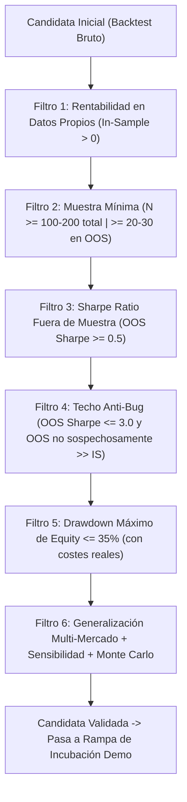
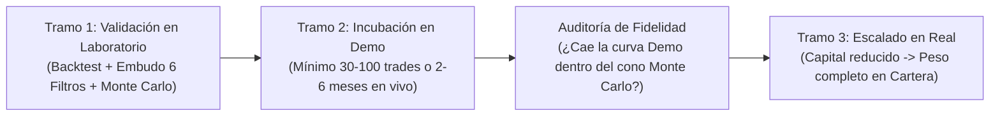

# 03. Validación Cuantitativa, Pruebas de Estrés y Robustez (Anti-Overfitting)

> **Fuente:** Extracción técnica del canal `@Techain_Trading_Bots` (Ignacio N. Ayago).
> **Enfoque:** El embudo de 6 filtros institucionales, separación *In-Sample / Out-of-Sample*, Walk-Forward en 5 ventanas, Test de Sensibilidad Paramétrica, Simulación de Monte Carlo (*Bootstrap*) y la Rampa de Incubación en Demo.

---

## 1. El Enemigo Número 1: La Sobreoptimización (*Overfitting / Curve-Fitting*)

> *"Si torturas los datos lo suficiente, confesarán cualquier cosa. Cuando pruebas decenas de miles de combinaciones sobre el pasado, siempre aparece una que parece un genio solo por azar. No has creado un sistema: has memorizado las respuestas de un examen antiguo."* (Vídeos #007, #008, #023, #030).

Un **backtest simple no es una validación**: es únicamente una fotografía de un pasado concreto con un orden exacto de velas que jamás se repetirá de forma idéntica. En el experimento masivo del **Vídeo #036** (*AI put over 12,000 trading strategies to the test*), de **12.000 validaciones ejecutadas**, únicamente **847 superaron el embudo de filtros ($\approx 7\%$)**, y menos de un tercio de las supervivientes superó el test de sensibilidad paramétrica.

---

## 2. El Embudo de 6 Filtros en Cascada (*Validation Suite* — Vídeos #002, #023, #027, #036)

En la metodología de Techain/StratOS, una estrategia no se evalúa en un solo activo ni con una sola métrica, sino que se somete a un **embudo secuencial de 6 filtros eliminatorios** (si falla en uno solo, queda descartada):

### Detalle Técnico de Cada Puerta del Embudo:
1. **Filtro 1 — Costes Reales y Regímenes Múltiples:**
   * Mínimo de **2 a 6 años de histórico** con datos de calidad institucional (sin huecos ni *ticks* inventados), incluyendo al menos **3 regímenes de mercado distintos** (alcista, bajista y lateral) y aplicando *spread* variable real, comisión por lote, *swap* y deslizamiento (*slippage*).
2. **Filtro 2 — Significancia Estadística ($N$):**
   * Menos de $30$ operaciones totales = invalidez estadística absoluta.
   * Estándar exigido para 2–6 años: **$\ge 100$ a $200$ operaciones** (y al menos $20\text{--}30$ operaciones dentro de cada ventana *Out-of-Sample*).
3. **Filtro 3 — Ventaja Fuera de Muestra (`OOS Sharpe >= 0.5`):**
   * En los datos que el algoritmo **jamás vio durante su diseño/optimización**, el *Sharpe Ratio* debe ser **$\ge 0.50$**.
4. **Filtro 4 — Detector de Sesgos y Anomalías (`OOS Sharpe <= 3.0` y Consistencia `IS vs. OOS`):**
   * Si el *Sharpe Ratio* fuera de muestra supera **$3.0$**, o si el rendimiento *Out-of-Sample* es sospechosamente muy superior al *In-Sample*, **se bloquea o investiga** (suele indicar un *look-ahead bias*, lectura de vela abierta aún no cerrada o una racha fortuita en una muestra minúscula).
5. **Filtro 5 — Control de Caída (`Max Drawdown <= 35%`):**
   * El *Drawdown* máximo de *Equity* no puede superar el $35\%$ (buscando idealmente $<15\%\text{--}20\%$).
6. **Filtro 6 — Generalización Multi-Activo:**
   * *"Un Edge que solo existe en un par y en un único timeframe no es un Edge, es una anécdota"* (Vídeo #023 y #035). La lógica se lanza simultáneamente contra una cesta de activos de la misma familia para comprobar que el principio subyacente generaliza.

---

## 3. Los 5 Checks contra el *Overfitting* (Vídeo #007 y #035)

Además del embudo básico, todo bot debe superar tres pruebas estructurales profundas:

### A. Prueba de Ventanas Cronológicas (*In-Sample / Out-of-Sample* 70/30 y *Walk-Forward* de 5 Ventanas)
* **Método Clásico (70/30):** Se diseñan y congelan las reglas entre 2020 y 2024 (70 % del histórico) y se ejecuta sin tocar un solo parámetro en 2025–2026 (30 % restante).
* **Método de 5 Ventanas (Vídeo #007):** Se dividen los 6 años de histórico en **5 ventanas cronológicas**. Dentro de cada ventana se compara la primera mitad (*In-Sample*) contra la segunda mitad (*Out-of-Sample*). Son **5 exámenes independientes en lugar de uno solo**.
* **Criterio de Aprobación:** El rendimiento medio *Out-of-Sample* no puede caer por debajo de **la mitad ($50\%$)** del rendimiento *In-Sample*. Si se desploma, el bot memorizó el pasado.

### B. Test de Sensibilidad Paramétrica (*Parameter Sensitivity / Heatmap*)
* *"Si tu estrategia pasa de ganadora a desastre porque el periodo del RSI cambia de 14 a 13 o el multiplicador de ATR pasa de 1.5 a 1.7, no tienes un sistema: tienes una mesa que se cae si desplazas la pata 1 centímetro"* (Vídeos #023, #032, #035, #036).
* **Procedimiento:**
  * Se perturban todos los parámetros clave de la estrategia en un rango de **$\pm 5\%$ a $\pm 20\%$** alrededor del valor central (generando una malla de $25\text{--}35$ variantes vecinas).
* **Umbrales de Veredicto (Vídeo #023 y #036):**
  * **Robusto (Verde):** **$\ge 70\%$ de las variantes vecinas** sobreviven y mantienen esperanza matemática positiva. (En los mejores sistemas mostrados en el canal, como la variante V16 del Vídeo #036, sobreviven 27 de 31 variantes = $87\%$).
  * **Neutral (Amarillo):** Entre $40\%$ y $69\%$ de supervivencia.
  * **Frágil / Sobreoptimizado (Rojo):** **$< 40\%$ de las variantes** sobreviven. Descarte inmediato.

### C. Simulación de Monte Carlo (*Bootstrapping* de 1.000 Vidas Alternativas)
* **Qué hace exactamente:** Toma la lista de operaciones del *backtest* y baraja su orden aleatoriamente (con reemplazo y variaciones de fricción) **1.000 veces**, generando 1.000 curvas de capital alternativas con su propio *Drawdown* máximo.
* **Definiciones y Umbrales del Motor Monte Carlo (Vídeos #001, #002, #004, #007, #014):**
  1. **Umbral de Ruina:** Se define como que el *Equity* caiga al **$50\%$ del depósito inicial**. La probabilidad de ruina en las 1.000 simulaciones debe ser **$\le 5\%$** (idealmente $< 1\%$).
  2. **Drawdown en el Percentil 95 ($DD_{P95}$):** Representa el peor escenario realista (el 5 % de las peores rachas posibles):
     * **$DD_{P95} < 15\%$:** Zona cómoda (*Sello Sólido*).
     * **$15\% \le DD_{P95} \le 35\%$:** Zona de precaución (*Sello Neutral* — requiere ajustar lotaje a la baja).
     * **$DD_{P95} > 35\%$:** **Sello Frágil — Descarte o rediseño obligatorio** (aunque el *backtest* histórico haya tenido solo un 18 % de *Drawdown*).
  3. **Dispersión de Retorno Final ($P_{95} / P_{5}$):** Si el capital final entre el percentil 5 y el percentil 95 difiere en **más de un factor $3\times$**, el sistema depende excesivamente de la suerte en la secuencia de órdenes (Vídeo #007).

---

## 4. La Rampa de Incubación: Del Simulador a la Cuenta Real (Vídeos #010, #023, #028, #030)

Una regla innegociable de Ignacio Ayago es que **ningún bot pasa jamás del *backtest* directamente a una cuenta con dinero real**, por perfecta que haya salido la validación matemática.

### Reglas Operativas de la Incubación en Demo:
1. **En Demo NO se mide el beneficio, se mide la FIDELIDAD (Vídeo #010):**
   * La pregunta en cada operación de la cuenta Demo no es *"¿He ganado dinero hoy?"*, sino: **"¿Ha ejecutado el bot exactamente lo que dictan las reglas de su ficha técnica y dentro de los parámetros de fricción esperados?"**
2. **Duración se mide en Operaciones, no solo en Días (Vídeo #023, #028, #030):**
   * Un bot con 9 operaciones en Demo no dice absolutamente nada.
   * **Mínimo estricto:** Entre **30 y 100 operaciones ejecutadas en vivo** (o un periodo de **2 a 6 meses** de incubación; en el Vídeo #028 muestra cómo sus 32 bots pasan hasta 6 meses en el *pipeline* de incubación, donde cae el 80–90 % de los candidatos).
3. **El Criterio de las Bandas de Monte Carlo (Vídeo #023):**
   * Se superpone la curva de resultados reales de la cuenta Demo sobre el **cono de bandas de probabilidad de Monte Carlo** generado en la fase de validación.
   * **Si la curva Demo navega dentro de las bandas de Monte Carlo:** El sistema se comporta en el mercado real tal como predijo el modelo estadístico $\implies$ **Asciende a Cuenta Real (`GO`)**.
   * **Si la curva Demo se sale por debajo de la banda inferior de Monte Carlo:** Existe un fallo estructural de ejecución (*spread* real mayor al simulado, *slippage* del bróker, latencia o cambio estructural de mercado) $\implies$ **Se aborta antes de perder un solo dólar real**.
