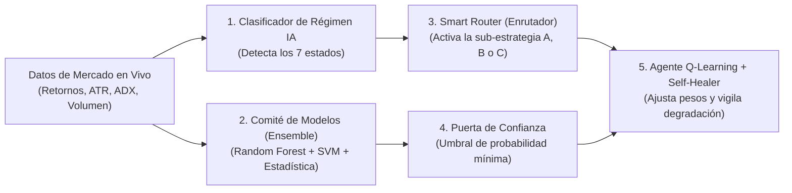

# 04. Inteligencia Artificial y Machine Learning Aplicado al Trading Cuantitativo

> **Fuente:** Extracción técnica del canal `@Techain_Trading_Bots` (Ignacio N. Ayago) — Vídeos #015, #020, #022, #036, #037, #049, #061, #063, #066, #067, #068, #079, #093.
> **Enfoque:** Por qué fallan los LLMs generalistas al programar bots, arquitectura de bloques de IA deterministas, *Q-Learning* (Aprendizaje por Refuerzo), Comités de Votación (*Ensemble ML*: Random Forest + SVM), *Self-Healer* y evolución genética (*Genome Lab*).

---

## 1. Por Qué Fallan los Chatbots Generalistas (ChatGPT / Claude) Escribiendo MQL5 Directo

En los vídeos #015, #027 y #036, Ignacio Ayago explica un error crítico del trader minorista actual: pedirle directamente a un LLM generalista (*ChatGPT*, *Claude*, etc.) que escriba un *Expert Advisor* en código MQL4/MQL5 desde cero.

### Los 3 Fallos Estructurales de los LLMs Escribiendo Código de Trading en Crudo:
1. **No determinismo y alucinaciones sintácticas:** Ante el mismo *prompt*, un modelo de lenguaje generalista produce código distinto en cada intento, mezclando a menudo funciones de MQL4 con MQL5 o inventando manejadores de indicadores (`iMA`, `CopyBuffer`) que no compilan o leen la vela `0` (abierta) introduciendo *look-ahead bias*.
2. **Ausencia de capas de seguridad financiera:** Un chatbot programa la condición de entrada que le pides, pero omite la normalización del `TickValue` del bróker, el control de margen libre, los filtros de *spread* máximo, el manejo de errores de requote (`TRADE_RETCODE`) y las paradas de emergencia.
3. **Incapacidad de supervisión del usuario:** Si el usuario no es programador cuantitativo en C++/MQL5, pone a operar una "caja negra" que no sabe auditar (*"Un suicidio financiero en toda regla"* — Vídeo #027).

### La Solución Arquitectónica (IA Híbrida + Transpilador Determinista):
* **La IA NO escribe el código MQL5 final directamente:** La IA (ej. *AI Wizard*, *Copilot AI*, *Legendary Bot Designer*) actúa como **arquitecto de alto nivel** que traduce la intención o el análisis estadístico en un **grafo estructurado de bloques pre-auditados** (JSON / DSL).
* **El Motor Compilador Determinista** toma ese grafo de nodos y ensambla el código MQL4/MQL5 utilizando plantillas institucionales verificadas con **cero errores de compilación** (*"Mismo diseño, mismo código, siempre"* — Vídeo #015).

---

## 2. Arquitectura de IA *In-Bot*: Los 30 Bloques en 6 Familias (Vídeos #015, #049, #061, #066, #068)

Más allá de usar IA para *diseñar* el bot en la plataforma web, el nivel avanzado consiste en **incrustar algoritmos de Machine Learning y Aprendizaje por Refuerzo dentro del propio código del Expert Advisor** para que se ejecuten en tiempo real dentro de MetaTrader 5.

Según la radiografía técnica de los vídeos #015, #049, #061, #066 y #067, estos módulos se estructuran en **5 componentes de inteligencia embebida**:

### 1. El Clasificador de Régimen IA y el *Smart Router* (Sistema A-B-C — Vídeos #061 y #062)
* Los bots tradicionales quiebran porque son **estáticos** (aplican una única lógica fija aunque el mercado cambie de tendencia a rango o a pánico).
* El **Nodo Clasificador de Régimen IA** evalúa en tiempo real las características del mercado (*features*: volatilidad relativa ATR, direccionalidad ADX, pendiente estructural, curtosis/dispersión) y clasifica el estado actual dentro de los **7 regímenes canónicos**.
* Conectado a él, el **Smart Router de 7 Regímenes** funciona como una aguja ferroviaria ("Bot Camaleón"):
  * Si detecta *Tendencia*, enruta el flujo hacia la rama de **Estrategia A (Convexa / Seguimiento)**.
  * Si detecta *Rango*, apaga la rama A y enciende la **Estrategia B (Cóncava / Reversión a la Media)**.
  * Si detecta *Caos / Alta Volatilidad*, enruta hacia **hibernación / cierre de protección**.

### 2. Comité de Votación en Tiempo Real (*Ensemble Learning* — Vídeo #049)
En lugar de confiar en un único indicador o modelo, se implementa un **sistema de votación multi-modelo** (*Ensemble*) donde hasta **5 modelos de IA/ML votan en tiempo real** antes de autorizar una operación:
* **Detector de Régimen de Mercado** (Contexto macroestructural).
* **Random Forest (*Bosque Aleatorio*):** Conjunto de árboles de decisión que evalúan múltiples variables no lineales sin sobreajustarse tanto como un árbol único. *(En el Vídeo #065 advierte también sobre cómo evitar el mal uso/sobreajuste del Random Forest si no se filtra por muestra fuera de muestra).*
* **Máquina de Vectores de Soporte (*SVM — Support Vector Machine*):** Clasificador geométrico que busca el hiperplano óptimo para separar configuraciones alcistas de bajistas en espacios multidimensionales.
* **Puerta de Confianza (*Confidence Gate*):** Solo deja pasar la orden si el consenso ponderado de los modelos supera un umbral estricto de probabilidad (ej. $>65\%\text{--}75\%$).

### 3. El Agente Estratégico con *Q-Learning* (Aprendizaje por Refuerzo — Vídeos #015, #063, #066, #068)
* **El Problema de la Dimensionalidad:** El humano no puede procesar simultáneamente docenas de variables de estado en múltiples marcos temporales sin caer en fatiga o sesgo emocional (Vídeo #063).
* **Cómo funciona el bloque *Q-Learning* dentro de MT5:**
  * Basado en **Aprendizaje por Refuerzo (*Reinforcement Learning*)**, el agente mantiene una matriz/tabla de valores de acción-estado $Q(s, a)$ donde:
    * **Estado ($s$):** Combinación discretizada del régimen actual de mercado, volatilidad, sesión horaria y racha reciente.
    * **Acción ($a$):** Operar con peso normal, reducir exposición, filtrar la entrada o mantenerse fuera.
    * **Recompensa ($r$):** Resultado ajustado al riesgo de cada operación cerrada por el propio bot en MetaTrader.
  * Con cada operación ejecutada, el agente actualiza su política mediante la ecuación de Bellman, **aprendiendo de sus propios aciertos y errores sin salir de MetaTrader** y penalizando los estados donde la estrategia base pierde eficiencia.

### 4. El *Self-Healer* (Autorreparador y Guardián de Degradación — Vídeos #015 y #067)
* Todo sistema algorítmico sufre degradación con el paso de los meses (*alpha decay*).
* El módulo **Self-Healer** monitoriza en vivo la desviación de las métricas reales del bot (*Win Rate* móvil, *Profit Factor* rodante, *Drawdown* y `Z-Score` de rachas) frente a su "huella digital" de *backtest*.
* Si detecta que las métricas se degradan más allá de la tolerancia estadística, **entra en acción automáticamente**: reduce el lotaje, recalibra los multiplicadores de volatilidad o pone el bot en cuarentena antes de que dañe la cuenta.

### 5. *Genome Lab IA* y *Vision Lab* (Evolución Genética y Proyecciones — Vídeos #022 y #079)
* **Genome Lab IA:** Utiliza algoritmos evolutivos/genéticos (mutación, cruce de bloques y selección natural guiada por el embudo de validación *Out-of-Sample*) para evolucionar estrategias existentes, "amputando" reglas perdedoras (*Logical Amputation* — Vídeo #078) y fusionando bloques con ventaja estadística (*Atomizar y Fusionar estrategias* — Vídeo #079).
* **Vision Lab / Motor de Proyección Multi-Modelo (Vídeo #022):** Combina decenas de modelos estadísticos, estacionalidad histórica, VaR al 95 %, ATR anualizado y aprendizaje profundo para proyectar conos de probabilidad futura sobre un activo y **derivar automáticamente un bot editable en el lienzo** adaptado a ese escenario.
